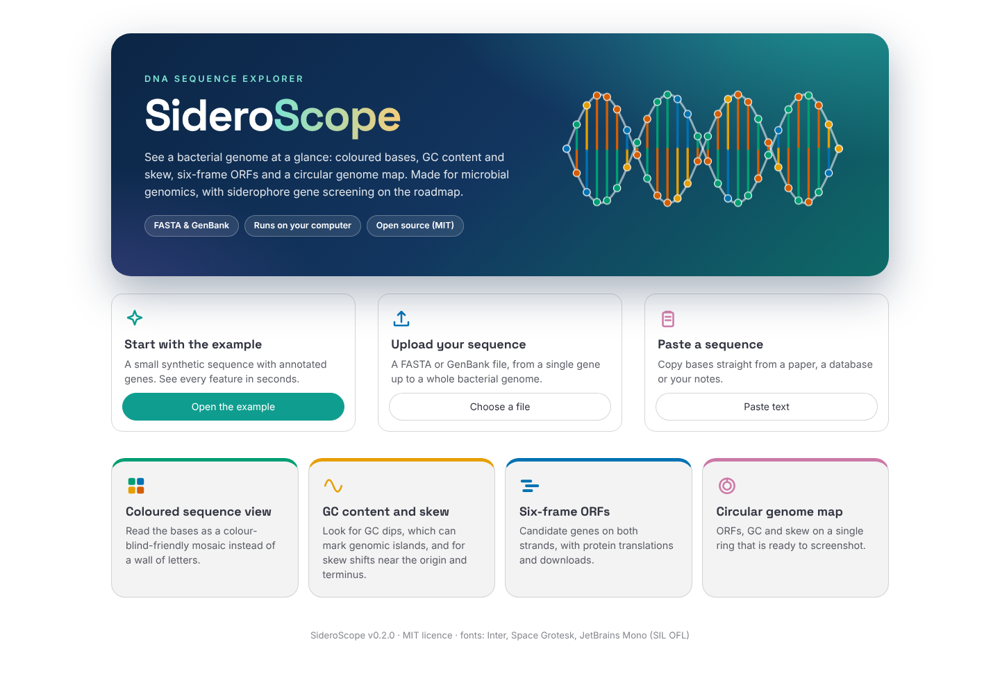
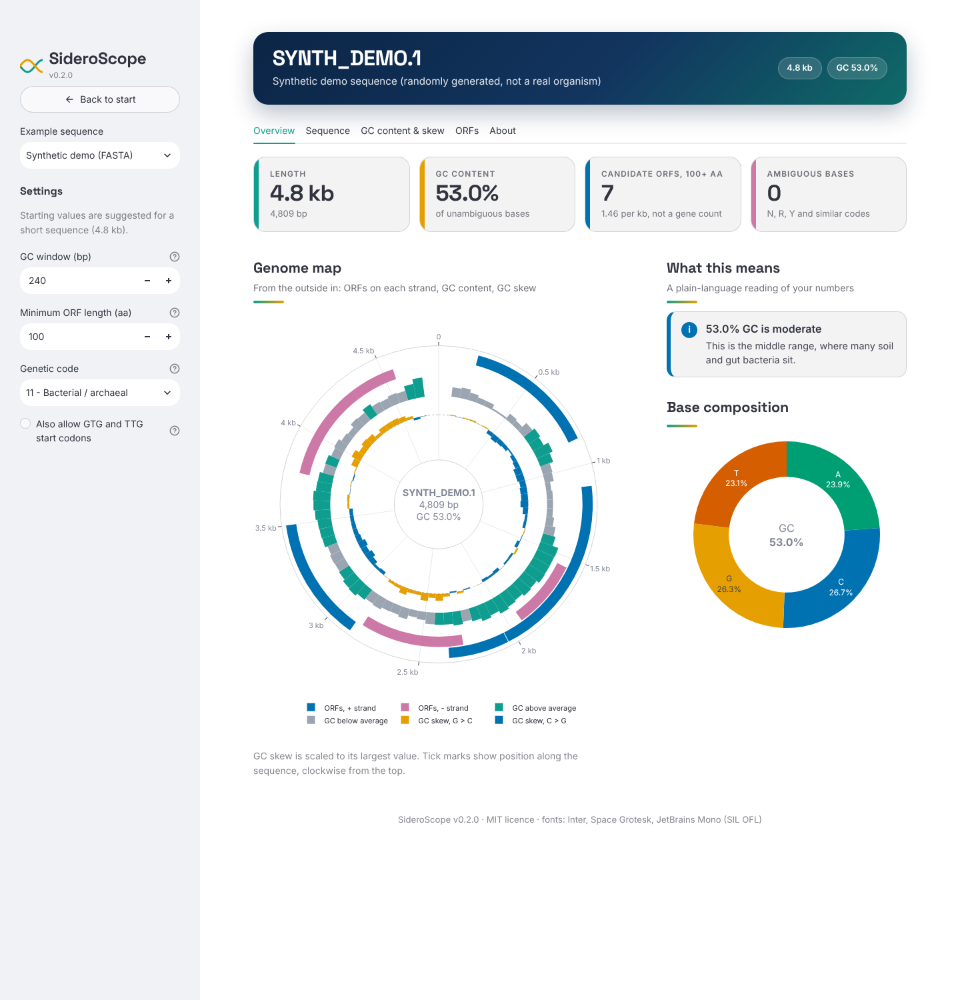

# SideroScope 🧬

**An interactive DNA sequence explorer for microbial genomics: coloured bases, GC content and skew, and six-frame ORFs, in your browser.**

Reading a sequence as endless lines of A, C, G and T is hard. SideroScope takes a FASTA or GenBank file (or a pasted sequence) and turns it into something you can look at and explore. It started as a tool for screening soil bacterial sequences in siderophore research, and it is built to grow in that direction (see the [roadmap](#roadmap)).





*Screenshots show the bundled synthetic demo sequence, not a real organism.*

## Features (v0.2)

- **Circular genome map**: ORFs on each strand, GC content and GC skew on one ring, ready to screenshot.
- **"What this means" panel**: plain-language notes on GC class, whether the ORF count is plausible for the genome size, a possible replication origin from cumulative GC skew, and AT-rich stretches that may be genomic islands. Each note says how sure it can be.
- **Settings that fit the sequence**: window size and minimum ORF length start at values suited to a gene, a contig or a whole genome.
- **Coloured sequence view**: bases wrapped into lines with position labels, using a colour-blind-friendly palette. Hover for exact positions.
- **GC content and GC skew**: sliding-window plots, plus cumulative skew (useful for spotting the origin and terminus of replication in many bacterial chromosomes).
- **Six-frame ORF finder**: candidate ORFs on both strands with an interactive map, a sortable table, protein translations, and CSV / FASTA downloads.
- **GenBank support**: annotated CDS features are drawn as outlines under the predicted ORFs, so you can compare annotation and prediction.
- **Bacterial genetic code**: table 11 by default (table 1 also available), with optional GTG / TTG start codons.
- **Runs locally**: your sequences never leave your computer.

## Quick start

You need Python 3.10 or newer (tested on 3.13).

```bash
git clone https://github.com/YOUR-USERNAME/sideroscope.git
cd sideroscope

python -m venv .venv
source .venv/bin/activate        # Windows: .venv\Scripts\activate

pip install -r requirements.txt
streamlit run app.py
```

Streamlit prints a local address (usually http://localhost:8501) and opens it in your browser.

## Using your own data

The bundled files in `examples/` are **randomly generated demo sequences, not a real organism**. To explore real data:

1. Open a record on [NCBI Nucleotide](https://www.ncbi.nlm.nih.gov/nuccore/).
2. Choose **Send to → Complete Record → File**, then format **FASTA** or **GenBank (full)**.
3. In SideroScope pick **Upload file**, or paste the sequence into **Paste sequence**.

Multi-record files are supported; choose a record in the sidebar. Very large sequences work too: a 2.5 Mb genome loads and is analysed in about 8 seconds on a laptop-class machine.

## How it works

| Output | Definition |
| --- | --- |
| GC content | (G + C) / (A + C + G + T) × 100. Ambiguous bases (N, R, Y …) are ignored. |
| GC skew | (G − C) / (G + C) per window. |
| Cumulative skew | Running sum of the window skews, scaled by step / window so the shape does not depend on the step size. |
| ORF | Start codon (ATG, optionally GTG / TTG) to the first in-frame stop (TAA, TAG, TGA). The longest ORF is kept when several starts share a stop. |
| Frames | +1 to +3 start at bases 1 to 3 of the forward strand. −1 to −3 read the reverse complement from the last base of the forward strand. |

Coordinates are 1-based and inclusive on the forward strand, and ORF coordinates include the stop codon.

## Limitations

- ORFs are **candidates, not gene predictions**. Random sequence contains ORFs too, especially short ones. For gene calling use a dedicated tool such as Prodigal, Glimmer or Bakta.
- Because the longest ORF is reported, the start can sit upstream of the true start codon.
- ORFs that run off the end of the sequence without a stop codon are not reported.
- Only genetic code tables 1 and 11 are supported.
- The notes in the "What this means" panel are rules of thumb. The replication-origin estimate assumes a complete circular chromosome, and the AT-rich stretches are only hints of acquired DNA.
- GC-rich genomes (such as *Pseudomonas*) contain many chance ORFs, so the ORF count is not a gene count. The panel warns when the number looks too high for the genome size.

## Project layout

```
sideroscope/
├── app.py                   # Streamlit interface
├── siderascope/
│   ├── core.py              # parsing, GC / skew, ORF finding (no UI code)
│   ├── insights.py          # plain-language notes shown in the app
│   ├── plots.py             # Plotly figures, including the circular map
│   └── ui.py                # look and feel: CSS, hero, cards
├── static/fonts/            # bundled fonts (Inter, Space Grotesk, JetBrains Mono) and licences
├── docs/                    # README screenshots
├── examples/                # synthetic demo data + the script that makes it
├── tests/                   # pytest suite (core logic, figures, headless app runs)
├── requirements.txt
└── .github/workflows/       # runs the tests on every push
```

## Development

```bash
pip install pytest
pytest
```

The core analysis in `siderascope/core.py` has no Streamlit dependency, so you can use it directly in a script or notebook:

```python
from siderascope.core import parse_sequences, find_orfs

record = parse_sequences(open("my_contig.fasta").read())[0]
orfs = find_orfs(record.sequence, min_aa=100)
print(orfs.head())
```

## Roadmap

- [ ] **Siderophore gene scan**: search the predicted ORFs against HMM profiles for siderophore biosynthesis (NRPS and NIS synthetases) and transport proteins, and highlight hits on the ORF map
- [ ] Gene-cluster map with gene arrows for GenBank input
- [ ] Support for antiSMASH GenBank output (not yet tested)
- [ ] Per-ORF codon usage and GC3
- [ ] Export figures as PNG / SVG
- [ ] Command-line mode and a PyPI package

Feature requests and bug reports are very welcome: please open a GitHub issue.

## Citing

If SideroScope helps your work, please cite it using the metadata in [`CITATION.cff`](CITATION.cff) (GitHub shows a "Cite this repository" button).

## Acknowledgements

Fonts are bundled so the app works offline: Inter, Space Grotesk and JetBrains Mono, all under the SIL Open Font License (licences in `static/fonts/`).

Built with [Biopython](https://biopython.org/), [Plotly](https://plotly.com/python/), [Streamlit](https://streamlit.io/), [pandas](https://pandas.pydata.org/) and [NumPy](https://numpy.org/). Please also cite Biopython if you use SideroScope in a publication: Cock PJA *et al.* (2009) Biopython: freely available Python tools for computational molecular biology and bioinformatics. *Bioinformatics* 25(11):1422–1423.

## License

[MIT](LICENSE)
